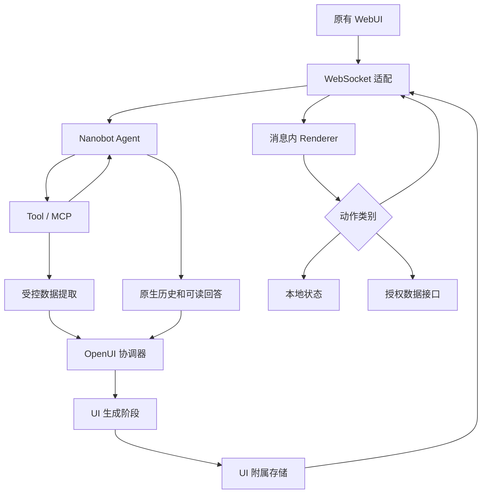
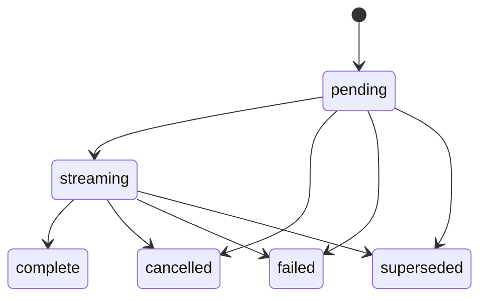

# Nanobot Issue #1：OpenUI 功能与技术详细设计

版本：设计稿 v1.0  
日期：2026-10-29（北京时间）  
对象：yuklcool/nanobot Issue #1  
状态：待实现；本文是实施设计，不代表功能已开发、测试通过或发布。  
基线：本次核对 stable 与 develop 相同，均为 8f7a7d17590de7ab187650381894dba2b9e060ab；Issue 将其标记为官方 v0.4.0 基线。main 比 stable 领先 12 个提交。执行开发前重新固定实际 SHA。

## 0. 开发 Agent 接手入口

关联任务：[Issue #1](https://github.com/yuklcool/nanobot/issues/1)。本文件是仓库内的详细设计与实施依据，Issue 负责目标范围、阶段状态和最终验收。遇到两者冲突，先结合当前源码核实，在对应 PR 中说明并同步修订；不得静默删减需求或把拟议接口当成现有实现。

### 开始前必读

1. 仓库根目录 AGENTS.md 及其列出的适用专题指南、工作目录下的更细粒度 AGENTS.md。
2. Issue #1 的当前正文和后续讨论。
3. 本文件，重点是第 2、7–10、14–16 节。
4. 当前 develop 的实际源码、锁文件和测试入口；本文 SHA 与版本信息是设计核对时的快照，开始工作时重新确认。

### 执行顺序

- 从最新 develop 创建短期功能分支；stable 保持纯官方稳定版本基线，不写入定制改造。
- 先完成 P0：SDK/React 18 兼容验证、增量渲染、同 Session 动作回传、刷新恢复三个最小闭环，以及稳定消息锚点、权限、取消和输入幂等的接入验证。
- P0 交付可复现命令、锁定版本、基线 SHA、必要宿主改动清单、验证结果和未解决问题；将其纳入架构/PoC PR，不能把未跑的测试写成通过。
- P0 阻断项解决后依次实现 P1、P2、P3，每个 PR 标记对应阶段和验收编号 AT01–AT24。
- 设计变化与代码在同一 PR 更新；涉及范围或成功标准变化时同步 Issue #1。
- 文档 PR、PoC PR 和中间功能 PR 使用“Refs #1”，不要使用会自动关闭总任务的关键词。完成全部验收后再关闭 Issue #1。
- 不擅自发布 tag、镜像、GitHub Release 或覆盖生产分支；发布操作按维护者指令和仓库发布规范执行。

### 每个开发 PR 的交接记录

说明：解决的具体问题、对应阶段/验收编号、变更文件与上游冲突风险、实际运行的命令及结果、未完成事项和下一步。修改宿主接入点时记录必要性和改动范围；涉及会话、权限、写操作或恢复时，附对应真实链路验证证据。

建议将 P0 的结果整理为 docs/openui-p0-validation.md，后续运行与维护说明整理为 docs/openui-integration.md；这些文件尚待相应开发阶段产生，不应预先声明其内容或验证成功。

## 1. 设计结论

采用“Nanobot 原生 Agent + 独立 OpenUI 输出模块 + 现有 React 消息区嵌入 Renderer + 原 WebSocket 扩展 + UI 附属存储”的方案。

用户在一个对话线程中完成提问、查看工具进度、操作卡片、填写表单和继续追问。原有工具执行、MCP、记忆和会话仍由 Nanobot 管理。OpenUI 负责把受控数据组织为交互视图；UI 生成阶段不拥有业务工具执行权限。

OpenUI Skill 作为开发参考资料。运行时不要求安装该 Skill，不要求使用 Thesys Gateway，不新增第二个聊天系统。

本稿中的 ui.* 事件、数据结构、目录、配置、错误码、数值预算均为拟议项目契约。它们不是 Nanobot 现成 API，也不是 OpenUI 官方协议。OpenUI SDK 的实际导入和参数以 P0 锁定版本为准。

### 1.1 必须交付的用户能力

| 编号 | 能力 | 用户感知 |
| --- | --- | --- |
| F01 | 三种输出模式 | 输入框可选自动、文本、交互 |
| F02 | 混合消息 | Markdown、工具活动、附件、交互卡片共同出现在原线程 |
| F03 | 流式卡片 | 生成完成前能看到有效内容逐步出现 |
| F04 | 本地操作 | 展开、排序、筛选等立即响应 |
| F05 | 继续对话 | 点击详情、分析、提交需求后在当前会话继续执行 |
| F06 | 受控数据操作 | 某些查询和修改可不经过 LLM，由已授权后端处理 |
| F07 | 状态恢复 | 刷新、切换会话、断线后恢复卡片和已保存的非敏感草稿 |
| F08 | 失败降级 | 卡片失败时仍能读到业务结果，能单独重试展示 |
| F09 | 渠道兼容 | CLI、Telegram 和旧 WebUI 保持普通文本体验 |
| F10 | 上游可维护 | 主体代码集中新增目录，宿主改动有清单和兼容测试 |

### 1.2 本次不扩展的范围

不重写 Agent Loop、MCP、Memory 或全部 WebUI；不新建通用插件市场；不实现任意 HTML/JS 网页执行；不扩展多租户管理平台。身份与工作区权限继承当前部署已有的安全模型，OpenUI 不能创造比宿主更大的权限。

## 2. 已核实的代码基础和待验证项

### 2.1 已核实事实

| 位置 | 本次读取确认的能力 | 对设计的影响 |
| --- | --- | --- |
| nanobot/agent/hook.py | AgentTurnHookFactory、after_execute_tool、after_run 等 | 可按回合采集经过策略筛选的数据；不能将 after_run 当作持久化完成 |
| nanobot/agent/loop.py | _run_turn 后 _persist_turn；finish_turn 后发布 session_turn_persisted | 优先在业务回合持久化后启动 UI 任务；监听注册方式仍须审查 |
| nanobot/agent/turn_delivery.py | 负责 routing、session_generation、complete 和 turn_completed | 不能让 UI 扩展破坏原 turn_end 语义 |
| nanobot/webui/outbound_wire.py | 显式类型和投影边界 | 扩展必须进入协议适配，不应任意塞入未识别事件 |
| webui/src/hooks/useNanobotStream.ts | send、stop、history paging、recovery、stream_end/turn_end 区分 | 复用发送和历史机制，UI 增量由独立 store 维护 |
| webui/src/lib/types.ts | UIMessage 和 turn phase 等既有类型 | 浏览器生成的 message.id 不能直接当后端持久化主键 |
| webui/package.json | React 18.3、Vite 5、TypeScript 5.7；Vitest、Playwright 脚本 | P0 必须验证 OpenUI 包的实际构建及运行兼容性 |

OpenUI 官方 Renderer 文档列出 response、library、isStreaming、onAction、initialState、onStateUpdate、toolProvider 等能力。当前源码中的 react-lang/package.json 标注 1.0.2，但这只说明读取到的源码版本，不等于确认 npm 发布物和 Nanobot 兼容；不能直接据此宣布版本锁定完成。

### 2.2 P0 阻断项

1. 获取宿主身份、workspace scope、session generation 的可信来源，确认事件订阅如何注册和注销。
2. 确认原生历史 record/response source 的稳定标识，以及流式消息与历史消息的对应关系。
3. 验证选定 SDK 的 React 18 构建、流式解析、动作、表单恢复和工具代理。
4. 验证新增 namespace 能通过 WebSocket 客户端校验、分发和重连机制。
5. 验证宿主输入队列能以稳定 client request ID 去重；不能只在前端防重复。
6. 验证原生取消、会话删除和同名会话重建可触发 UI 清理。
7. 确认已有测试、包管理器和镜像打包规则，形成宿主改动清单。

这些是需要通过 PoC 证明的接入点。本文不声称已跑过安装、构建、E2E 或实机 Docker 测试。

## 3. 用户交互设计

### 3.1 页面区域

沿用当前聊天布局：

- 会话侧栏：继续显示已有会话；卡片不形成另一个会话目录。
- 消息区：保留现有文字、工具轨迹和附件；在所属回答中加入一个或多个 OpenUI block。
- 输入区：增加“自动 / 文本 / 交互”选择，保存本会话偏好；服务端功能开关优先。
- 卡片头：标题、数据时间、状态；历史或过期数据明确标注。
- 卡片操作区：只展示允许执行的动作；按钮文案、风险说明和最终确认由应用组件控制。
- 设置项：功能开关、默认模式、模型继承状态、可用组件和预算；普通用户界面不展示原始协议。

默认继承原 WebUI 主题；使用浅色中性面板、蓝色操作色、统一圆角和间距。暗色模式跟随宿主。窄屏改为纵向排列，宽表格局部横向滚动；不能使整个聊天页面横向溢出。

### 3.2 输出模式

| 模式 | 路由规则 | 不满足条件时 |
| --- | --- | --- |
| 文本 markdown | 完整走原有路径，不创建 UI 模型请求 | 无额外工作 |
| 交互 openui | 明确申请 UI；仍需客户端支持且数据适合 | 正常文字，并简明解释无法展示原因 |
| 自动 auto | 明确的比较、列表、表单、筛选需求才启用 | 保持文字 |

自动模式第一版采用可解释的服务端规则：用户意图信号、结果形态、组件可用性、预算和客户端能力共同判断。不为判断是否需要 UI 再额外调用一个路由模型。路由结果和原因码可观测，不把业务数据写入日志。

在多设备场景，模式属于请求与会话；Renderer 能力属于连接。生成任务按当前请求接受的能力固定，不能因另一个旧客户端连接而改变。

### 3.3 首轮示例：任务列表

以下任务名称和动作只是验收场景；不表示 Nanobot 已内置相应业务 API。

用户：“列出待处理任务，让我能筛选并查看详情。”

1. 原生消息区显示用户问题。
2. 原 Agent 运行，工具活动显示“查询任务”等真实事件及耗时。
3. 业务结果先按原路径形成可读回答，例如“找到 8 项待处理任务”。
4. 同一回答下显示“正在生成交互视图”。
5. 卡片标题、摘要、表格逐步出现；未完成的部分保持骨架或略去。
6. 本地筛选只改变当前加载的数据；若需要全量筛选，明确调用后端查询。
7. “分析这项任务”产生同会话的新用户回合。
8. Agent 必要时查询详情，产生新的回答及卡片。

原文字回答保留。P1 先保证文字和卡片共存；P2 可默认折叠较长的重复文字，但必须能展开查看，不能因卡片失败而丢失原答案。

### 3.4 表单行为

- 表单有稳定 form_id，字段有稳定 field_id，不按数组下标识别。
- 校验覆盖必填、枚举、长度、范围和跨字段关系；前后端均校验。
- 客户端即时提示格式错误；服务端负责最终业务校验。
- 非敏感草稿使用防抖保存，显示“保存中 / 已保存 / 保存失败”。
- 密码、token、凭据等禁止进入通用草稿持久化。
- 提交时附带当前完整字段值，不能依赖防抖请求刚好已完成。
- 同一卡片一次操作未确认结果前锁定对应提交按钮。
- 用户提交后，可读操作摘要显示在当前对话中；内部 JSON 不直接展示。
- 多设备编辑发生版本冲突时提示重新加载或重新提交，不静默覆盖。

### 3.5 消息内交互与展开查看

首版在聊天消息内完成操作。宽表和复杂图表可提供“展开查看”，使用同一 block store 的受控弹层或侧面板，不能复制一套独立状态。弹层关闭后返回原滚动位置；键盘 Escape、焦点回归、屏幕阅读器标签都必须可用。

## 4. 总体架构与责任



### 4.1 模块职责

| 模块 | 输入 | 输出 | 边界 |
| --- | --- | --- | --- |
| EligibilityPolicy | 请求模式、能力、预算 | 是否生成及原因 | 不查询业务工具 |
| ToolResultCollector | 工具返回与 provenance | 受控展示候选 | 不保留隐藏推理，不把全部工具原文外送 |
| ResultAdapter | 注册的数据 schema、结果 | DisplayBundle | 未适配结果降级 |
| UiCoordinator | 已提交回合、DisplayBundle | UI 任务、状态事件 | 不重新执行业务工具 |
| UiGenerator | 组件规范、数据引用、用户展示意图 | OpenUI Lang 流 | 不传入 Tool/MCP 执行器 |
| UiEventStore | block、revision、事件 | 可回放快照与增量 | 不替代原生 transcript |
| ActionGateway | 已验证身份、动作请求 | 本地/数据/Agent 路由结果 | 不信任模型决定权限 |
| HostAdapter | 宿主事件和服务接口 | 上述模块需要的最小契约 | 上游差异集中在此处 |
| FrontendAdapter | UI 事件、历史锚点 | block store | 不重写全部原消息投影 |
| RendererBoundary | Lang、library、状态 | React UI | 隔离解析、渲染和资源错误 |

### 4.2 不增加独立聊天服务

业务请求、UI 增量和 Agent 动作共用现有 WebSocket 的身份和连接管理。UI 快照、状态写入、数据 Query 可以复用现有 HTTP API 的鉴权，也可以通过既有 requestMutation 类机制承载。它们是辅助接口，不构成第二套 Agent 会话。

首版保持原 Python 服务加前端静态资源的部署形态。Node/Bun 只在构建时用于生成 SDK prompt/spec，不默认增加运行时 Node 服务。

## 5. UI 生成设计

### 5.1 默认采用受控的两阶段输出

阶段 A：原 Agent 完成理解、工具调用和可读回答，并保存原回合。  
阶段 B：独立展示任务将受控数据和展示意图交给当前模型，流式输出 OpenUI Lang。

阶段 B 复用宿主 Provider、模型快照、凭证来源、用量计量和预算；使用独立的消息列表，不能复用可能携带原完整上下文的 provider conversation continuation 状态。不得污染原 Agent 的运行状态或记忆。

原 Agent 常见工具运行不受 UI Prompt 干扰；UI 失败可只重试阶段 B；普通文本请求不增加模型调用。

简单纯展示任务未来可增加专用直接生成路径，但必须沿用相同数据、预算和动作边界；首版不以侵入 Provider 流或让所有回复都变成 Lang 为代价节省一次调用。

### 5.2 DisplayBundle：展示数据合同

拟议结构：

```json
{
  "schema_version": 1,
  "bundle_id": "db_01",
  "turn_id": "t_01",
  "summary_text": "找到 8 项待处理任务",
  "datasets": [
    {
      "data_ref": "ds_01",
      "schema_id": "task.list.v1",
      "columns": [
        {"key": "id", "type": "string"},
        {"key": "title", "type": "string"},
        {"key": "status", "type": "string"}
      ],
      "row_count": 8,
      "captured_at": "2026-10-29T14:40:00Z",
      "source_tool_call_id": "tc_01"
    }
  ],
  "allowed_action_ids": ["task.inspect", "task.analyze"],
  "presentation": {"kind": "table", "locale": "zh-CN"}
}
```

身份、权限范围与 session generation 存储在服务端上下文，不接受模型赋值。

- 使用已有结构化工具返回时，通过明确 schema 的 adapter 提取字段。
- MCP 未给结构化结果时，不假装 JSON 结构总是存在；使用受限解析/业务适配，失败回退到文字。
- 可以截断行数、列数和长文本，但必须显示“部分数据”及真实总数。
- 截断和过滤应保留稳定业务 ID，避免显示序号被误当资源 ID。
- 日志和模型输入只包含授权范围内的必要字段。
- 未确认结构的自然语言摘要属于模型解释，不能标记为确定性统计结果。

### 5.3 模型负责布局，真实数值从数据引用读取

对于关键表格、指标和图表，建议新增少量带 data_ref 的自定义组件，例如 DataTable、MetricValue、DataChart。它们是本项目拟议组件，不是声称 SDK 已提供的同名 API。

模型选择“显示哪些已允许字段、采用何种布局”，由组件从已授权的 DisplayBundle 快照取值。不能让模型重新抄写全部业务行并把它当作真实数据。

聚合值应由工具或确定性代码计算，再通过引用提供；图表系列和轴字段必须在 schema 中存在。空数据、单位和时间范围有固定展示规则。无法验证的数值不显示为业务统计。

### 5.4 Prompt 与组件规范同源

构建时从前端 library 生成完整 OpenUI prompt/spec 和 library_hash，一起打入 Python 安装包/镜像与前端资源。Python 加载版本化产物，不手抄 OpenUI 语法规范。

动态内容仅通过数据消息传递：展示意图、数据描述、允许的 action/data 引用。用户文字、工具原文不能被拼入系统规则。语言规范、可用组件和动作列表必须与该回合声明的 library_hash 相匹配。

第一版使用一个受限组件集，避免跨语言动态生成整套 component library。多组件集以后以多个预生成 profile 扩展。

### 5.5 流式与错误处理

1. ui.begin 创建稳定 block，不替换已经展示的原文字。
2. 服务器对 Lang 流做长度、时间和编码约束，累计存储并发送 delta。
3. 前端将累计内容传给官方 Renderer，isStreaming 与该 block 状态绑定。
4. 对不完整流不做简单正则判错；使用 SDK 解析报告判断。
5. 流式期间不允许外部写操作。部分组件可以显示，未完成表单不可提交。
6. 完成后本地解析通过，启用交互；服务端仍对每次动作独立鉴权和校验。
7. 最多一次自动展示修复。只携带受限错误码、相关 Lang 和原 DisplayBundle；不再次运行业务工具。
8. 持续失败则回退可读回答，并提供“重试交互视图”。

服务器的 complete 仅表示源流完整持久化，不表示该 Lang 获得业务权限或已经由浏览器成功呈现。浏览器的 rendered/parse_failed 是独立状态。客户端上报可被伪造，只用于体验和有额度限制的纠错，不能作为授权依据。

Python 首版不自研 Lang 解析器，也不以正则声称完成全部语法或安全验证。若后续需要发布前的服务端语法验证，必须使用与前端同版本的官方 JS parser，在明确的隔离运行方案中实现，另行评估运行时依赖。

## 6. 首版组件和操作矩阵

| 类别 | 首版组件能力 | 数据与行为限制 |
| --- | --- | --- |
| 布局 | 卡片、分组、纵横布局、分隔 | 深度和节点数受限 |
| 文本 | 标题、正文、提示、标签 | 无原始 HTML 执行 |
| 数据 | 指标、表格、键值详情、列表 | 关键业务数据由 data_ref 驱动 |
| 图表 | 柱状、折线、占比 | 必须有真实字段、单位、空态 |
| 表单 | 文本、数字、单选、多选、日期 | schema 白名单，禁止凭据采集 |
| 动作 | 查看详情、继续分析、提交、刷新 | action registry 显式登记 |
| 展示状态 | 加载、空数据、错误、已过期 | 由应用状态控制 |
| 附件 | 现有附件组件复用 | 不从模型伪造可下载链接 |

第一版控制在约 12–18 个实际注册组件，按场景必要性选取。禁止模型传入任意 CSS、任意组件导入、iframe、脚本、事件处理源码。链接和图片经专用组件过滤协议和来源；敏感业务页面不自动加载任意第三方资源。

组件 key 在流式增量中保持稳定，避免输入框被反复 remount。流期间可先禁止编辑；完成后恢复已有状态。组件参数顺序属于兼容合同，修改时不能随意重排已有位置参数。

## 7. 三类动作的完整设计

### 7.1 本地 UI 动作

折叠、tab、当前快照排序、已加载数据的筛选等在浏览器执行，不创建 Agent 回合，不触发 LLM。涉及可恢复状态的变更通过 ui.state.patch 保存白名单字段。

“本地筛选 50 条已加载数据”必须与“查询全部 10000 条数据”区分；后者属于 Query。

### 7.2 受控 Query / Mutation

OpenUI 当前文档明确提供 Query、Mutation 和 toolProvider。项目将 toolProvider 映射到自己的后端动作代理，不把整个 Nanobot ToolRegistry 或 MCP 客户端暴露给浏览器。

建议初始白名单：

| 动作 | 类型 | 默认策略 |
| --- | --- | --- |
| ui.dataset.read | Query | 仅读取本 block 已绑定的授权快照 |
| ui.dataset.page | Query | 有明确 adapter 时加载更多，绑定原过滤条件 |
| registered.resource.refresh | Query | 明确刷新实时数据；历史加载不自动刷新 |
| registered.resource.update | Mutation | 仅显式登记的低风险操作；后端权限与版本校验 |
| 任意 shell / exec / 自由 SQL | 不开放 | 不能通过 UI 数据代理获得通用执行能力 |

登记信息包含 action_id、类型、输入 schema、结果 schema、权限检查器、资源解析器、幂等支持、确认策略、审计字段与超时预算。模型只能引用已有登记项，不能发明可执行函数。

服务端根据真实语义判定读写，不能因模型称为 Query 就视作只读。无合格 adapter 的工具仅允许走 Agent 动作，继续接受原工具权限约束。

Query/Mutation 的浏览器结果不会天然成为 Agent 上下文。本项目对成功的业务修改保存可读操作回执和结果引用；后续 Agent 回合按需读入最小结果，或重新查询当前状态。大量查询和筛选无需逐条写入 Agent 记忆。

### 7.3 Agent 动作

动作表现：“分析这条记录”“按这个条件重新生成方案”等。

处理链路：

1. Renderer 的 onAction 进入 action mapper。
2. 将结构化引用和表单值交给既有 send() 的扩展 options。
3. 服务端入站适配先验证身份、session、block、revision 和 action。
4. 服务端从注册动作生成标准化用户请求；客户端 humanFriendlyMessage 仅作非可信展示数据。
5. 通过原生会话输入队列提交新回合，使用稳定请求 ID 去重。
6. 原 Agent 继续使用原 Session、Tool/MCP 和 Memory。
7. 新结果产生新回答块，旧卡片保留；必要时标记旧数据过期。

不得同时调用独立 ui.action 和 send() 两条执行路径造成重复回合。Agent 类使用 send() 携带 uiAction 元数据；Query/Mutation 类由数据代理处理。

拟议元数据：

```json
{
  "uiAction": {
    "version": 1,
    "block_id": "ui_01",
    "revision": 1,
    "action_id": "task.analyze",
    "params": {"record_id": "task_08"},
    "form_state": {"period": "7d"},
    "idempotency_key": "req_01"
  }
}
```

实际外层消息继续使用当前 Nanobot 入站协议；不直接把此 JSON 当作现有 send() 的已支持参数。

### 7.4 权限、确认和幂等

校验顺序：连接身份 → 工作区权限 → 会话 generation → block 归属 → action 白名单 → 参数 schema → 资源权限/版本 → 预算 → 确认 → 幂等登记 → 执行。

有风险的写操作使用宿主控制的确认界面，显示实际资源、动作和参数。确认 token 绑定身份、参数摘要、资源版本与过期时间；参数变更必须重新确认。模型不能伪造“已确认”。

幂等键作用域至少包含主体、session generation、block、action。保存规范化 payload hash：相同 key + 相同请求返回原操作状态；相同 key + 不同参数返回冲突。

本系统可以对接收请求和内部队列实现去重，但不能仅靠一张幂等表保证任意外部 MCP 的 exactly-once。若远端已经执行而回执丢失，应标记 unknown，查询结果或人工核实；没有远端幂等/对账能力时禁止盲目自动重试写操作。

## 8. 回合、UI 生命周期与排序

### 8.1 保留原 turn_end 语义

原业务回合保存完成后，可以产生展示任务。原 turn_end 仍代表原 Agent 工作结束，不能被 UI 模块偷偷延迟或重新定义。

前端分别展示：

- agent_running：Agent 正在执行。
- ui_generating：结果已得到，正在生成交互视图。
- done：原 Agent 已结束，关联的 UI 任务也已终止或完成。

原完成提示音等交互可在支持 OpenUI 的连接中等待组合状态结束；旧客户端保持原行为。UI 阶段耗时与 token 单独记录，不能混入某个工具耗时。

展示任务不占用 Agent 的会话执行锁。用户可继续输入。新回合开始时，默认取消上一回合尚未完成的展示任务，保留文字；已经完成的卡片继续存在。

### 8.2 UI 服务端状态机



failed/cancelled/superseded/complete 对同一 revision 都是终态。重试创建新 revision，不将旧终态原地改回 streaming。已完成卡片的后端动作另有状态机。

动作状态：received → validating → awaiting_confirmation 或 queued → running → succeeded/failed/unknown/cancelled。未入队时可取消；远端操作已开始时不能虚假承诺已撤销。

### 8.3 顺序锚点

UI block 绑定：

- 服务端 principal/workspace scope。
- 原生 session_key 与 session_generation。
- 原生 turn_id。
- canonical message/record/source 标识（P0 确认可用字段）。
- message 内的 block ordinal。

不能使用 Date.now、数组索引或浏览器随机 UIMessage.id 作为跨刷新主键。若原生记录没有稳定 message_id，适配层必须以已经持久化的 turn + phase/sequence + source 建立并保存锚点映射；需要 P0 证明不会冲突。

首版插入点固定为所属回合最终可读回答之后，不按 UI 事件到达时的聊天尾部追加。这样下一轮已经开始时，迟到的上一轮卡片也不会插错位置。非最终工具活动不直接生成可写卡片。

## 9. WebSocket 扩展合同

### 9.1 能力协商

在既有连接/attach 协议允许的位置增加 namespaced capabilities：

```json
{
  "openui": {
    "protocol_versions": [1],
    "library_hashes": ["nanobot-ui-v1-HASH"],
    "actions": true,
    "state_restore": true
  }
}
```

服务端返回选择结果。没有协商、版本不匹配、功能关闭时不发送 Lang，不创建 UI 生成任务。不能依赖“旧客户端会自动忽略未知事件”。

多连接投递按连接能力过滤，不能将 Lang 作为广播普通 message 发送。

### 9.2 事件类型

| 拟议事件 | 含义 | 持久化 |
| --- | --- | --- |
| ui.begin | 建立 block/revision、锚点与版本 | 是 |
| ui.delta | 增量 Lang | 有界日志，之后可压缩 |
| ui.complete | 完整源内容已保存 | 是 |
| ui.error | 展示失败，提供公开错误码 | 是 |
| ui.cancel | 取消或被新请求取代 | 是 |
| ui.snapshot | 当前 block 的权威快照 | 对已有状态的读取 |
| ui.state.updated | 草稿或本地状态已保存 | 是 |
| ui.action.status | 操作进度和回执 | 是 |

事件外层沿用现有 chat_id，不另造一套路由标识。示意：

```json
{
  "event": "ui.delta",
  "schema_version": 1,
  "chat_id": "chat_01",
  "session_generation": "gen_01",
  "turn_id": "turn_01",
  "block_id": "ui_01",
  "revision": 1,
  "seq": 7,
  "format": "openui-lang",
  "library_hash": "nanobot-ui-v1-HASH",
  "delta": "..."
}
```

内部 session_key 不必原样暴露；服务端解析 chat_id 后始终再次检查访问权限。所有会话标识都不是授权凭证。

### 9.3 顺序、去重、缺口

seq 是每个 block/revision 内单调递增的持久化事件序号。重复 seq 丢弃；发现缺口时暂停应用后续 delta，请求自 last_seq 的补发或快照。

快照包含 revision、last_seq、完整 Lang、服务端状态、允许保存的组件状态及版本。接收快照时只替换相同 generation 且更新的 revision/seq；随后应用更高 seq 的缓冲事件。

complete 携带完整内容摘要和最终序号，若缺包则拉取快照，不直接把不完整字符串标记为成功。

generation 不匹配、过期 revision 或终态后的 delta 一律丢弃。切换会话时异步回调必须比较 owner token，不能更新当前另一会话的 store。

## 10. 持久化和恢复设计

### 10.1 独立附属 SQLite

建议在当前 Nanobot 数据目录增加独立 openui.sqlite，使用宿主相同的文件权限和备份范围。该路径是拟议配置，不写死用户主目录。单实例首版采用 WAL、短事务和有界批处理；多副本部署必须另外设计共享存储与任务互斥。

| 表 | 关键字段 | 用途 |
| --- | --- | --- |
| ui_blocks | scope、session_key、generation、turn_id、anchor、block_id、revision、status、library_hash、source、fallback_ref | UI 身份和最终快照 |
| ui_events | block_id、revision、seq、type、payload、created_at | 断线回放和事务 outbox |
| ui_datasets | data_ref、schema_id、source_tool_call_id、授权范围、快照、captured_at、expires_at | 受控业务数据 |
| ui_states | principal、block_id、revision、state_version、白名单 state | 草稿和筛选恢复 |
| ui_actions | 幂等键、payload_hash、action_id、状态、目标 turn_id、result_ref | 去重与结果核查 |
| ui_tombstones | session_key、generation、deleted_at | 删除与迟到写入拦截 |
| ui_schema_version | migration_id、applied_at | 附属库升级 |

主键和索引必须覆盖 scope + generation；不能仅凭用户可预测的 chat_id 隔离。

原 transcript 保留原有工具结果、文字和会话事实；UI 库不复制整个 transcript，不把隐藏推理持久化进去。必要的动作摘要走原生用户输入/受控上下文入口，不通过篡改旧历史实现。

### 10.2 双存储一致性

不宣称原生历史库与 UI 库天然具有跨库原子事务，采用可恢复的一致性设计：

1. Hook 阶段把经过筛选的展示候选暂存为 pending，尚不可交互。
2. 原回合持久化成功后，核对锚点，激活唯一 UI 任务。
3. UI 快照更新与对应 ui_events 写入同一附属库事务。
4. 事务提交后向 WebSocket 发送；发送失败可重放。
5. 进程重启时对账 pending/streaming：检查原回合存在且 generation 有效。
6. 原回合不存在时丢弃 pending；原结果存在但展示未完成时标记 interrupted，并提供单独重试。
7. 已经完成的业务工具不会因 UI 修复而重新执行。

崩溃恰好落在两库之间时可能只剩文字，这属于可接受降级；不允许出现可执行的孤立卡片。

### 10.3 刷新与历史分页

- 先复用原生历史分页得到当前页的 canonical 锚点和 turn IDs。
- 每页批量请求相应 UI block，避免每条消息一个请求。
- 两个结果按锚点合并；先出现文字时可在原位置显示轻量骨架。
- 订阅和历史读取使用 watermark/seq 合并，避免恢复期间丢事件。
- 恢复 Lang 与 initialState，再建立状态同步。
- 历史默认显示捕获时的快照和“数据截至…”。
- 历史 Query 默认由工具代理返回已存快照；只有用户明确刷新才查询实时资源。
- Mutation、Agent 动作、定时刷新在历史挂载时不自动触发。

SDK 的 initialState/onStateUpdate 是否完整覆盖所用 reactive state 必须实测。组件展开状态或不受支持的 SDK 内部状态由外层 store 保存白名单字段，不承诺任意组件状态都能自动恢复。

### 10.4 删除、重置、fork 和临时会话

- 删除：先写 generation tombstone 并取消 UI 作业，执行原删除，再异步清除附属记录；失败可重试。
- 同名会话重建：新 generation，旧事件和旧操作 token 全部失效。
- fork/分支会话：先继承只读快照；不能复制仍有效的写操作权限或确认 token。重新授权后生成新动作实例。
- 历史截断/回滚：删除断点之后 block，未删除部分保留原身份。
- 临时会话：UI 数据在内存或短期缓存，遵从宿主不落持久化的语义。
- 并行会话：各自取消令牌、模型快照、数据范围和 store，禁止共享可变状态。
- 保存失败：卡片不进入可写状态；显示文字和简明错误。

### 10.5 版本与回滚

每个 block 记录协议、SDK、组件库和 state schema 版本。小改动追加可选参数，不能重排组件位置参数。

旧 UI 由内置兼容库或有测试的迁移读取；无法安全兼容时展示原文字及“旧版交互视图暂不可用”。不从网络按历史版本任意加载脚本。

UI 数据迁移优先可追加、可重入；升级前备份。关闭开关保留附属数据但停止生成与动作，原生聊天继续工作。回滚版本遇到新 schema 应拒绝写入新库并文本降级，不能破坏数据。

## 11. 附属 API 草案

实际 URL 前缀和 RPC 方法名遵循 P0 审查后的现有路由；以下只定义职责。

| 操作 | 参数摘要 | 返回 |
| --- | --- | --- |
| ui.get_blocks | chat_id、generation、当前页 turn/anchor IDs | 有权限的 blocks 和 watermark |
| ui.resume | block_id、revision、last_seq | 增量事件或 snapshot |
| ui.state.patch | block_id、revision、expected_state_version、patch | 新 state_version |
| ui.data.call | block_id、revision、action_id、params、request_id | 结果或 operation_id |
| ui.confirm | operation_id、confirmation_token | 已确认操作状态 |
| ui.operation.get | operation_id | 权威状态和回执 |
| ui.retry | block_id、revision、request_id | 新 revision、同业务结果 |
| ui.cancel | block_id、revision、request_id | 终态 |

所有读取也验证权限，防止“不能写但可以读取别人的数据”。批量接口限制数量、总大小和深度。会话/资源无权限时避免通过错误详情泄露其存在。

错误码建议：UI_DISABLED、UNSUPPORTED_LIBRARY、STALE_GENERATION、STALE_REVISION、ACTION_NOT_ALLOWED、INVALID_PARAMS、RESOURCE_CONFLICT、IDEMPOTENCY_CONFLICT、CONFIRMATION_REQUIRED、BUDGET_EXCEEDED、RESULT_UNKNOWN、DATA_EXPIRED、UI_GENERATION_FAILED。

浏览器展示经过映射的中文提示，不展示堆栈、上游原始响应、SQL 或 token。

## 12. 配置、预算与观测

### 12.1 配置草案

```yaml
openui:
  enabled: false
  default_mode: auto
  model_policy: inherit_current_turn
  library_profile: nanobot-v1
  auto_repair_attempts: 1
  ui_timeout_seconds: 45
  max_output_tokens: 4096
  max_source_bytes: 131072
  max_state_bytes: 16384
  max_components: 100
  max_depth: 8
  first_page_rows: 50
  allow_mutations: false
```

以上为建议初始值和配置概念，不是当前 config.json 可直接识别的字段。最终命名、别名和默认值须遵从项目现有配置 schema。enabled 和 mutation 的默认关闭不等于关闭业务工具；只是限制新 UI 能力。

服务端限制预算和数据规模；组件数量、深度和渲染时间由前端边界限制并熔断。没有服务端 parser 时，不能声称后端已经验证全部组件节点。

### 12.2 性能目标

| 指标 | 建议初始验收目标 | 测量边界 |
| --- | --- | --- |
| 文本模式额外 LLM 请求 | 0 | 明确 markdown 或功能关闭 |
| UI 接收增量到绘制 | 前台 p95 小于 200ms | 固定测试设备、100 节点以内，不含模型推理 |
| 首个组件 | 必须早于 ui.complete | 确定性流测试保证，不承诺模型绝对秒数 |
| UI 事件发送批次 | 约 50–100ms 合并 | 结束/取消立即 flush |
| 草稿保存 | 约 500ms 防抖 | 提交使用当前完整值，不依赖保存时序 |
| 自动纠错 | 至多 1 次 | 每 block/revision-family 的预算共享 |
| 大数据 | 首屏最多 50 行，后续分页 | 不通过模型输出完整大表 |

业务耗时、UI 首 token、首组件、UI 总耗时、网络延迟和渲染时间分开统计。模型速度与网络状况未测量前不承诺“几秒必出图”。

### 12.3 观测

记录 generation_id、turn_id、block_id、revision、library_hash、错误码、耗时、token、重试次数和动作状态。请求 ID 可关联主 Agent 记录。

不默认记录完整表单值、工具返回、Lang 源码和用户隐私；调试导出必须明确启用并脱敏。统计展示生成率、fallback 率、解析失败率、状态恢复成功率、动作失败率与重复提交命中率。

## 13. 安全与正确性设计

| 风险 | 处理 |
| --- | --- |
| 模型伪造工具名称 | action registry 白名单，未知名称拒绝 |
| 模型伪造业务数据 | data_ref、schema 和来源校验，关键值由组件取真实快照 |
| 跨会话读写 | 主体、scope、session generation、block 归属联合检查 |
| XSS 或危险链接 | 不执行生成 HTML/JS；受控 Markdown、链接和图片组件；协议过滤 |
| 越权调用 MCP | 浏览器无 MCP 密钥，服务端逐动作授权 |
| 提示注入 | 工具文本作为非可信数据，不提升为系统指令 |
| 重复点击或网络重试 | 幂等账本、参数摘要、宿主队列去重、远端对账 |
| 模型伪造成功消息 | 实际操作状态由应用根据后端回执渲染 |
| 旧卡片修改新资源 | revision、资源版本与权限实时复核 |
| 卡片流触发副作用 | streaming/read-only/history 模式禁用 mutation |
| 过大或递归 UI | 字节、token、节点、深度、渲染熔断 |
| 草稿泄密 | 字段持久化白名单，敏感输入不保存 |
| 浏览器恢复引发写操作 | toolProvider 门禁、历史只读状态、用户触发证明及确认 |

不展示模型内部隐藏思考。沿用宿主当前允许公开的工具活动与进度；UI 模块不额外提取或广播 reasoning 字段。

## 14. 源码落点与上游合并策略

### 14.1 建议新增模块

| 路径 | 职责 |
| --- | --- |
| nanobot/openui/contracts.py | 请求、数据、事件 schema |
| nanobot/openui/policy.py | 模式、预算、组件和安全策略 |
| nanobot/openui/collector.py | 按回合采集授权展示候选 |
| nanobot/openui/result_adapters.py | 业务返回到 DisplayBundle |
| nanobot/openui/coordinator.py | UI 任务生命周期与取消 |
| nanobot/openui/generator.py | Provider 调用、增量、修复 |
| nanobot/openui/actions.py | 动作 registry、授权、确认、幂等 |
| nanobot/openui/store.py | 附属 SQLite 和迁移 |
| nanobot/openui/host_adapter.py | 宿主事件、模型、会话最薄适配 |
| nanobot/openui/generated/ | 构建生成的 prompt/spec/manifest |
| nanobot/webui/openui_wire.py | 扩展序列化和能力协商 |
| nanobot/webui/openui_routes.py | 读取、状态、数据动作接口 |
| webui/src/openui/library.tsx | 受限 SDK 组件库 |
| webui/src/openui/OpenUIBlock.tsx | Renderer、错误边界、历史模式 |
| webui/src/openui/store.ts | UI 状态机、顺序和去重 |
| webui/src/openui/actions.ts | SDK action 到宿主请求映射 |
| webui/src/openui/history.ts | 历史块恢复和锚点合并 |
| webui/src/openui/tool-provider.ts | 受控数据工具代理 |
| webui/src/openui/components/ | data_ref、按钮和表单包装 |
| docs/openui-integration.md | 安装、配置、协议、升级与回滚 |

命名为建议；按项目已有目录约定调整，不为了匹配本文移动原有代码。

### 14.2 允许的宿主改动

- 启动装配处注入 Hook factory、UI coordinator 和清理回调。
- WebSocket 连接及入站边界：协商、事件分发、uiAction 验证。
- 共享 client-events/type decoder：接受协商后的 OpenUI namespace。
- useNanobotStream.ts：send options 增加类型安全的 uiAction，衔接历史和取消。
- MessageBubble.tsx：一处 block 渲染入口；必要时会话完成状态组合。
- config schema 和 package manifest：新增开关与依赖。
- 若稳定消息锚点、持久化通知或入站幂等不足，增加窄小宿主接入点。

不预先承诺“只改三行”“完全不动 loop”或“永不冲突”。要求每个宿主改动有必要性说明、行数统计、契约测试与回退方案。

### 14.3 本次已确认的 main 差异

stable → main 比较结果显示，除了文档之外，实际调整包括：

- nanobot/channels/websocket/runtime.py 大幅精简。
- 新增 nanobot/webui/outbound_delivery.py。
- 删除 nanobot/webui/outbound_projection.py。
- 修改 outbound_wire.py、history.py、transcript.py。
- 修改 providers/base.py、MCP 实现及会话存储相关文件。

因此“develop 测试通过”不能替代合入 main 后验收。HostAdapter 必须覆盖 v0.4.0 与待发布合并代码的相关边界；不能直接把稳定版的投递细节复制到 main。

### 14.4 分支策略

stable 保持纯官方稳定版；feature/openui-* 从 develop 创建，PR 回 develop；发布前创建 release-candidate 将当前 main 与 develop 无损合并演练。验收必须针对最终待发布代码集合。

官方稳定升级采用单独同步分支核对 tag 与 SHA，再经 PR 更新 stable、合并到 develop、做回归和候选发布。不能让自动任务将 upstream/main 覆盖 stable；不能 reset/force push 抹除 main 现有 12 个提交。

若选择把 main 的额外上游提交提前无损合入 develop，也应作为独立基线整合 PR 评估和测试；本设计不默认为已执行。

## 15. 分阶段任务与依赖

| 阶段 | 工作包 | 交付物 | 阻断验收 |
| --- | --- | --- | --- |
| P0 | 分支/SDK/协议/锚点/Hook/权限 PoC | ADR、兼容矩阵、三个最小演示 | 流式、动作同 Session、刷新恢复均跑通 |
| P1-A | schema、store、capabilities、宿主适配 | 可回放的 UI block | 关闭功能原测试通过 |
| P1-B | DisplayBundle、Generator、Renderer | 真数据流式卡片 | UI 失败不重复工具 |
| P1-C | Agent action、表单、幂等 | 连续两轮工具交互演示 | 同会话、参数准确、越权失败 |
| P2-A | 本地状态、Query/Mutation 白名单 | 无 LLM 数据操作 | 真实后端回执与审计 |
| P2-B | 刷新/重连/分页/删除/版本迁移 | 故障恢复和兼容测试 | 乱序、重复、旧 generation 无串扰 |
| P2-C | 主题、移动端、无障碍、观测 | 产品质量报告 | 错误态和大数据体验合格 |
| P3 | release-candidate、镜像启动、升级演练 | 发布报告、文档、tag/镜像 | 最终代码集合全量通过 |

推荐 PR 粒度：契约与骨架 → 生成和数据 → 前端流 → 动作闭环 → 恢复与状态 → 数据代理 → 安全质量 → 发布。阶段之间保持功能开关；不能将未完成的 UI 动作默认暴露给所有用户。

不以未经 PoC 的人日估算作发布承诺。P0 完成后按实际需要改动的宿主边界评估工期。

## 16. 可执行验收场景

| 编号 | 场景与故障注入 | 必须观察到的结果 |
| --- | --- | --- |
| AT01 | 开关关闭发送普通问题 | 额外 UI LLM 请求为 0；原消息、工具、附件正常 |
| AT02 | 支持客户端请求任务列表 | 工具结果完成后 UI 流式出现，首组件早于 complete |
| AT03 | 同问题由旧客户端/CLI 发起 | 仅可读文本，无 Lang 泄漏 |
| AT04 | 点击一条记录继续分析 | 原 Session 新 turn，参数对应真实记录，至少再次执行一个真实测试工具 |
| AT05 | 表单必填缺失/非法枚举 | 前后端均拒绝；业务工具执行计数为 0 |
| AT06 | 双击并重发同 request ID | 同一操作或同一 Agent turn，不重复入队 |
| AT07 | 同幂等 key 改参数 | 冲突错误，不执行第二次 |
| AT08 | 本地筛选排序 | Agent/Provider 请求计数不增加 |
| AT09 | 受控 Query | 只调用登记后端，不触发 LLM；越权数据不可见 |
| AT10 | 已授权 Mutation | 只执行一次；回执与真实存储一致 |
| AT11 | Mutation 执行后断开回执 | 恢复查询 operation；无远端幂等时不盲目重试 |
| AT12 | UI 生成中断网重连 | 缺口补发或 snapshot；没有重复组件 |
| AT13 | 页面刷新、历史分页 | 原位置恢复卡片，非敏感草稿恢复，历史不自动写入 |
| AT14 | 生成时切换两个会话 | 不串数据、不串状态、不串 token |
| AT15 | 删除再创建同名会话 | 旧 generation 的 Lang/动作均不再被接纳 |
| AT16 | ui.complete 后迟到 delta | 不改变已完成内容 |
| AT17 | 解析失败、错误组件、超长流 | 有限修复或文字回退，业务工具计数不增加 |
| AT18 | 资源版本已改变 | 旧卡片提交冲突，提示刷新，不覆盖新数据 |
| AT19 | SDK/组件库不兼容 | 可读降级，不崩溃或加载任意旧脚本 |
| AT20 | 进程分别在两库提交间、发送前崩溃 | 对账后无孤立可写卡片，已完成业务不重复 |
| AT21 | 同时存在新旧客户端 | 仅支持连接收到 UI，原对话均可读 |
| AT22 | 恶意 URL、原始 HTML、越权 action | 组件或后端拒绝，没有脚本执行或越权调用 |
| AT23 | 资源在确认后被修改 | 提交重新验证版本，必要时重新确认 |
| AT24 | main 合并候选运行 | Python、WebUI、E2E、Docker 和上游合并回归通过 |

测试分层：

- 单元：状态机、schema、数据 adapter、权限、幂等、generation、版本冲突。
- 集成：真实会话队列 + 持久化 + WS；故障注入检验双库恢复。
- 浏览器：流式、表单、本地筛选、分页、切换、移动端与 SDK 解析边界。
- Provider 测试：确定性流用于协议断言，再用真实配置模型验证生成质量和用量。
- 发布测试：调用项目现有 typecheck/build/test/test:browser，以及对应 Python 与 Docker 流程；根据仓库实际命令执行，不在设计稿中伪造已通过记录。

E2E 的业务测试工具应提供可观测计数器、资源版本和幂等回执。发布演示还需至少一个真实可用 Tool/MCP 服务，不能仅使用前端假数据截图。

## 17. 最重要的实施约束

1. after_run 是计算完成，不是原生历史提交完成；先保存业务结果，再激活 UI。
2. stream_end、turn_end 和 ui.complete 是三件事，不能混为一个布尔值。
3. Lang 源码不是事实来源、权限来源或操作成功回执。
4. 浏览器随机 message ID 不是可靠历史锚点。
5. 历史加载不得重新执行 Mutation；Query 也要区分快照和实时。
6. 表单防抖状态不能代替提交时的完整参数。
7. 幂等登记不等于任意 MCP exactly-once；结果未知必须可见。
8. 功能关闭必须阻断 UI 模型调用、状态写入和新 UI 动作，同时保留原聊天能力。
9. SDK prompt、组件库、依赖版本和历史 schema 必须一起管理。
10. 首次发布针对 main 的真实合并结果验收，不只测 develop。

## 18. 依据与后续实施入口

本设计依据 2026-10-29 读取的 Issue、develop 源码和官方文档形成。本文档入库不代表 OpenUI 功能已实现；实际实现与验证进度以关联 PR 和 Issue #1 为准。

- Issue：https://github.com/yuklcool/nanobot/issues/1
- 固定 Nanobot 基线：https://github.com/yuklcool/nanobot/tree/8f7a7d17590de7ab187650381894dba2b9e060ab
- 分支比较：https://github.com/yuklcool/nanobot/compare/stable...main
- OpenUI：https://github.com/thesysdev/openui
- Renderer：https://www.openui.com/docs/openui-lang/renderer
- Interactivity：https://www.openui.com/docs/openui-lang/interactivity
- Query/Mutation：https://www.openui.com/docs/openui-lang/queries-mutations
- Component definition：https://www.openui.com/docs/openui-lang/defining-components
- Existing app reference：https://github.com/thesysdev/skills/blob/main/skills/openui/references/existing-app.md
- Direct provider reference：https://github.com/thesysdev/skills/blob/main/skills/openui/references/direct-provider.md
- Component library reference：https://github.com/thesysdev/skills/blob/main/skills/openui/references/component-library.md

后续编码的第一步：在 develop 的短期功能分支完成 P0，提交带演示和兼容矩阵的架构 PR。只有三个最小闭环都证实后，才按本文模块分工展开完整实现。
